# 3D GIS: Working with the 3D Object Layer

Sascha Brunner

<!--
- Show how a 3D model becomes an editable GIS feature and can move between applications.
- Source: European Summit PowerPoint 1; recording 00:00–02:36.
-->

---
layout: none
class: original-slide
title: Feedback
is: feedback
---

# Feedback

<!--
- Exact, uncropped export of original PowerPoint slide 2, including its phone frames, highlighted controls, blue arrows, captions and background.
- Invite feedback through the session survey. The closing reminder is retained.
- Source: PowerPoint 2.
-->

---

<div class="kicker">OUR ROUTE</div>

# From a model file to a GIS workflow

<div class="route">
  <div><span>01</span><strong>Understand</strong><p>Models, features and the scene cache</p></div>
  <div v-click="1"><span>02</span><strong>Create & upload</strong><p>Publish a layer and place a model</p></div>
  <div v-click="2"><span>03</span><strong>Locate correctly</strong><p>Origins, vertices and spatial references</p></div>
  <div v-click="3"><span>04</span><strong>Build on it</strong><p>Query, analyze and export</p></div>
</div>

<!--
- Begin with the user workflow, then explain the implementation behind it.
- Finish with the Prague, city export and IFC examples.
- Source: PowerPoint 3; recording 02:05–02:36.
-->

---
layout: intro
class: section-title
---

# 3D Object Layer key concepts

<!--
- Section title from original PowerPoint 4; introduce the next part briefly.
-->

---

<div class="kicker">3D LAYER TYPES · SESSION SCOPE</div>

# Our focus: 3D object layers for buildings

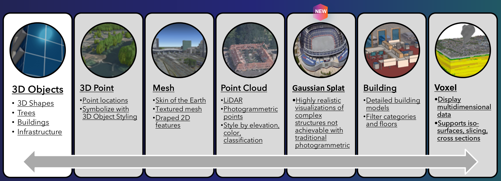

<!--
- Show the original illustrated overview from PowerPoint 9. Point to the leftmost 3D Objects column and explain buildings and architectural/design models as this session’s focus; 3D object layers also support other individually managed objects.
- Use 3D object editing when the workflow needs individually managed models.
- Distinguish this focus from the Building Scene Layer, which supports structured BIM categories, floors and interiors. Show how the other layer types provide different kinds of 3D content and context.
- Source: PowerPoint 9; recording 08:13–09:17 and Q&A 43:35 onward.
-->

---
clicks: 1
---

<div class="kicker">SEE IT IN CONTEXT</div>

# Upload a building into its geographic context

<div class="video-stage"></div>

<script setup>
import demoPoster from '/media/scene-viewer-poster.png';
</script>

<div v-click="1" class="demo-overlay">
  <SlidevVideo v-if="$clicks >= 1" autoplay="once" autoreset="slide" controls muted playsinline preload="metadata" :poster="demoPoster" aria-label="Upload a building model into the Zürich scene">
    <source src="/media/scene-viewer.mp4" type="video/mp4" />
  </SlidevVideo>
</div>

<!--
- Click to start the original embedded Scene Viewer video. Narrate over it.
- An integrated mesh provides the existing city context. Replace an existing building with a proposed IFC model.
- Its placement information puts it into the scene. Share the result and use scene tools for analysis.
- Source: PowerPoint 5, embedded video; recording 02:36–03:59. Esri.
-->

---
clicks: 1
---

<div class="kicker">THE SAME DATA, ANOTHER EXPERIENCE</div>

# Open the same web scene in XR

<div class="video-stage"></div>

<script setup>
import demoPoster from '/media/xr-poster.png';
</script>

<div v-click="1" class="demo-overlay">
  <SlidevVideo v-if="$clicks >= 1" autoplay="once" autoreset="slide" controls muted playsinline preload="metadata" :poster="demoPoster" aria-label="Experience the uploaded building in XR Viewer">
    <source src="/media/xr.mp4" type="video/mp4" />
  </SlidevVideo>
</div>

<!--
- Click to start the original embedded XR video.
- The model is stored in the platform, so another application can open the same web scene.
- Walk from the city context into the building; point out interiors and material properties.
- Source: PowerPoint 6, embedded video; recording 03:59–05:54. Esri.
-->

---
class: model-overview
---

<div class="kicker">KEY CONCEPTS</div>

# A 3D model becomes an editable GIS feature

<div class="model-flow">
  <div class="model-file"><strong>IFC · FBX<br>OBJ · GLB</strong><span>Original model</span></div>
  <div class="flow-arrow">→</div>
  <div class="layer-card"><span class="tag">3D OBJECT LAYER</span><strong>Location + attributes + model</strong><p>Retain the original asset.<br>Generate representations for web display.</p></div>
</div>
<div v-click="1" class="takeaway">A system of record for geolocated 3D objects.</div>

<div class="model-examples">
  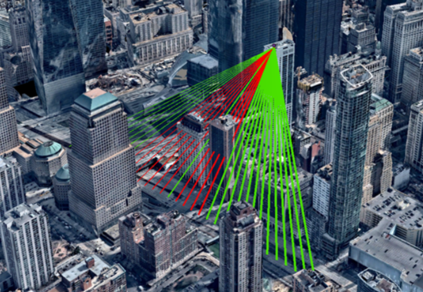
  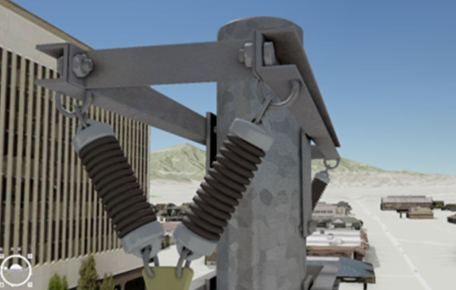
  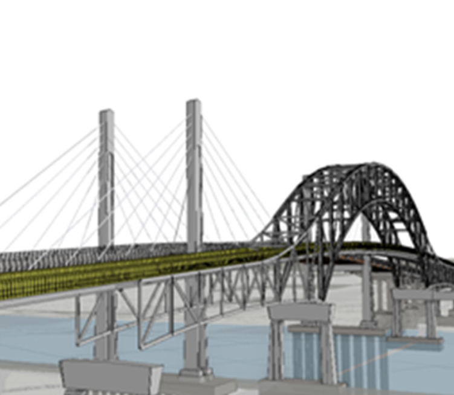
  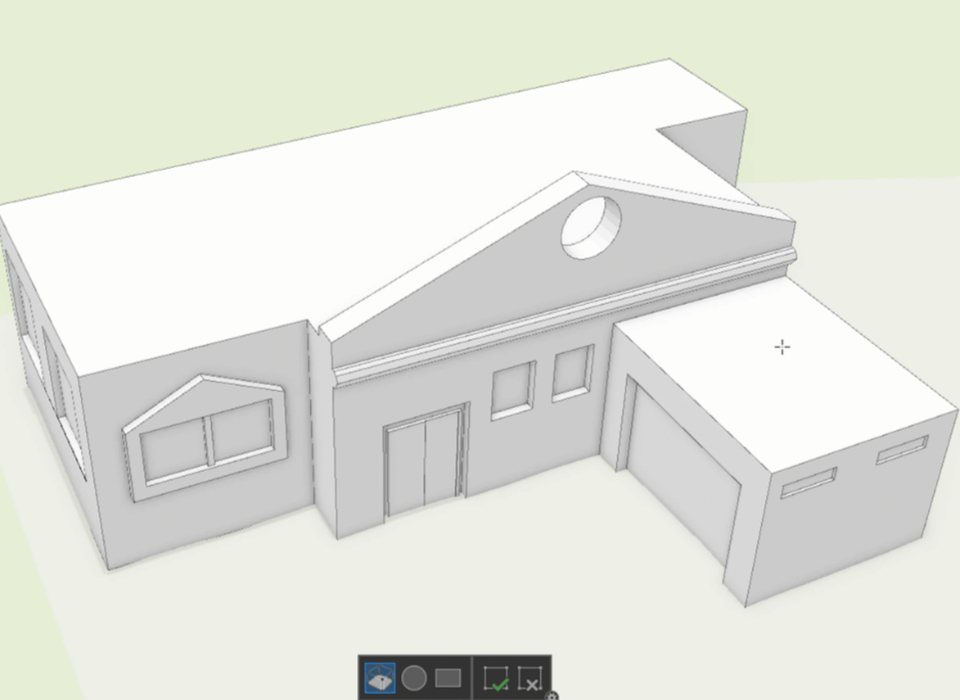
  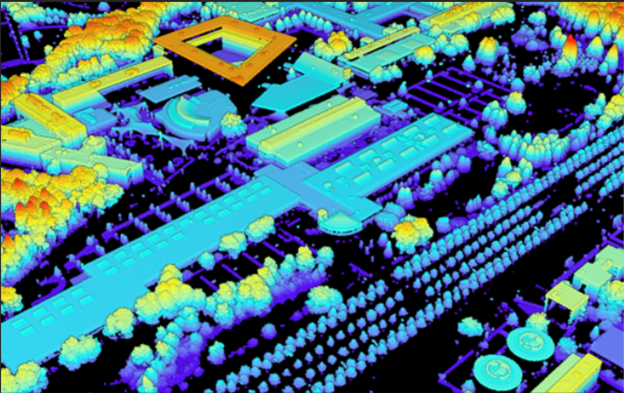
</div>

<!--
- The layer combines a 3D object scene layer and an associated 3D object feature layer.
- It supports multiple model formats and retains the original source, enabling round trips to modeling tools.
- Format availability depends on the service. The listed formats are examples.
- Source: PowerPoint 7–8; recording 05:54–08:13.
-->

---
layout: intro
class: section-title
---

# Scene layers and associated feature layers

<!--
- Section title from original PowerPoint 11; introduce the next part briefly.
-->

---
clicks: 2
---

<div class="kicker">TWO PARTS, ONE LAYER</div>

# The scene layer displays; the feature layer stores

<div class="original-diagram">
  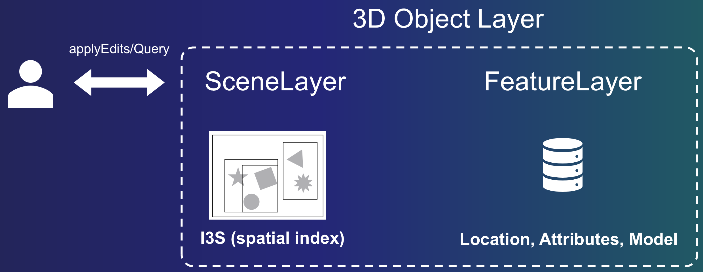
  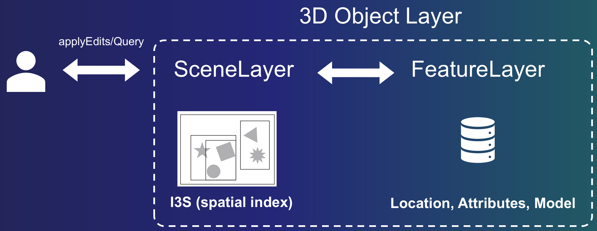
</div>
<div v-click="2" class="takeaway diagram-takeaway">Use the SceneLayer API for the standard SDK workflow.</div>

<!--
- Show the original PowerPoint 12 architecture, then click to reveal the connection from PowerPoint 13. Both items exist in the portal, but the SDK handles their relationship.
- Explain why the cache is useful when a layer contains a city rather than a single building.
- Editing permissions still need appropriate configuration on the associated feature layer.
- Source: PowerPoint 11–13; recording 09:17–10:40.
-->

---
clicks: 2
---

<div class="kicker">CACHING</div>

# Edits appear before the cache is rebuilt

<div class="original-diagram">
  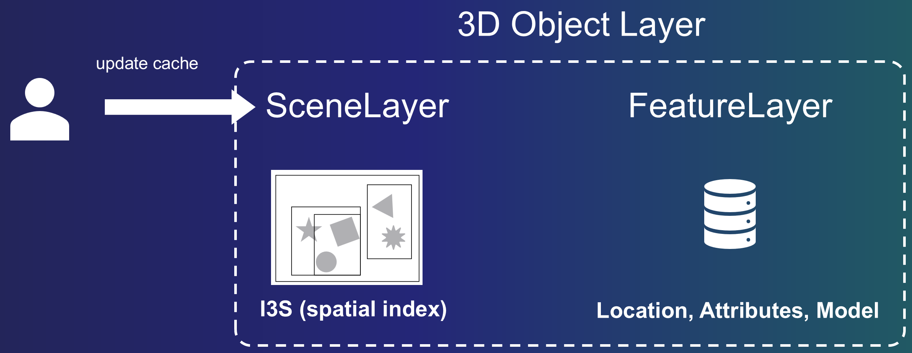
  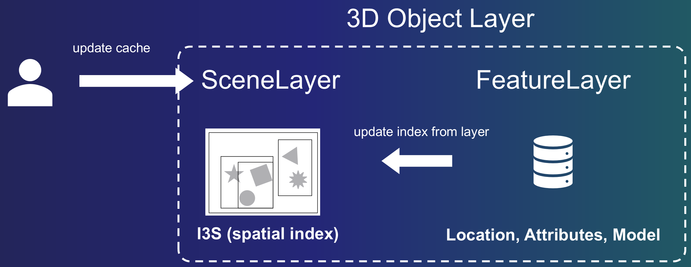
</div>
<div v-click="2" class="takeaway diagram-takeaway">More uncached edits can mean more work for the browser.</div>

<!--
- Show the original cache-update request from PowerPoint 14; click to reveal the feature-layer-to-index update from PowerPoint 15. A changed feature's cached copy is invalidated; the SDK displays the current feature instead.
- Rebuilding restores optimized loading. The right interval depends on edit volume and model complexity.
- Source: PowerPoint 14–15; recording 10:40–12:31.
- Reference: https://developers.arcgis.com/javascript/latest/3d-object-workflows/
-->

---

<div class="kicker">MANAGE THE CACHE</div>

# Rebuild after a batch of changes

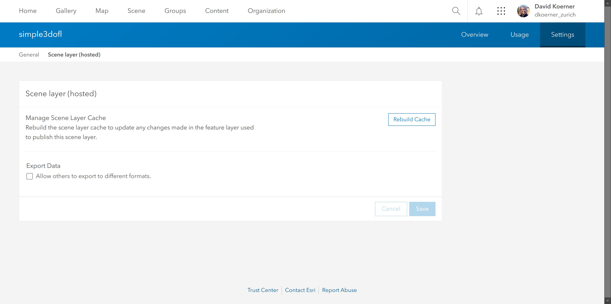

<!--
- Rebuilding consumes server resources; ArcGIS Online reports the credit cost.
- The layer owner or an administrator manages the cache. Choose full or partial rebuilds as supported.
- Do not promise an Online scheduling option from the source note. Enterprise scheduling is a separate deployment-specific topic.
- Source: PowerPoint 16; recording 11:28–12:31.
- Reference: https://doc.arcgis.com/en/arcgis-online/manage-data/manage-hosted-scene-layers.htm
-->

---

<div class="kicker">THE DEVELOPER'S VIEW</div>

# One layer, two services, familiar APIs

<div class="api-trio architecture-recap">
  <div><strong>Scene layer</strong><p>Fast display<br>I3S cache and levels of detail</p></div>
  <div v-click="1"><strong>Feature layer</strong><p>Spatial database<br>Location, attributes and original models</p></div>
  <div v-click="2"><strong>SceneLayer API</strong><code>queryFeatures()</code><code>applyEdits()</code><p>The SDK manages the connection.</p></div>
</div>
<div v-click="3" class="takeaway">One 3D object layer combines optimized display and editable model records.</div>

<!--
- Recap the scene layer and its associated feature layer before creating one.
- Use SceneLayer for the supported web-client workflow; the SDK manages the relationship with the associated feature layer.
- Query and edit with familiar feature workflows. Required service capabilities and permissions still apply.
- Source: PowerPoint 17; recording 12:00–12:31.
-->

---
layout: intro
class: section-title
---

# Creating 3D Object Layers

<!--
- Section title from original PowerPoint 18; introduce the next part briefly.
-->

---
layout: none
class: original-slide
title: Creating 3D Object Layers
clicks: 2
---

# Creating 3D Object Layers

<button class="original-slide-step" type="button" :aria-label="$clicks < 1 ? 'Show the first arrow and 3D layer dialog' : $clicks < 2 ? 'Show the second arrow and 3D object layer dialog' : 'Continue to the next slide'" @click.stop="$event.currentTarget.blur(); $nav.next()" @keydown.enter.stop @keydown.space.stop>
  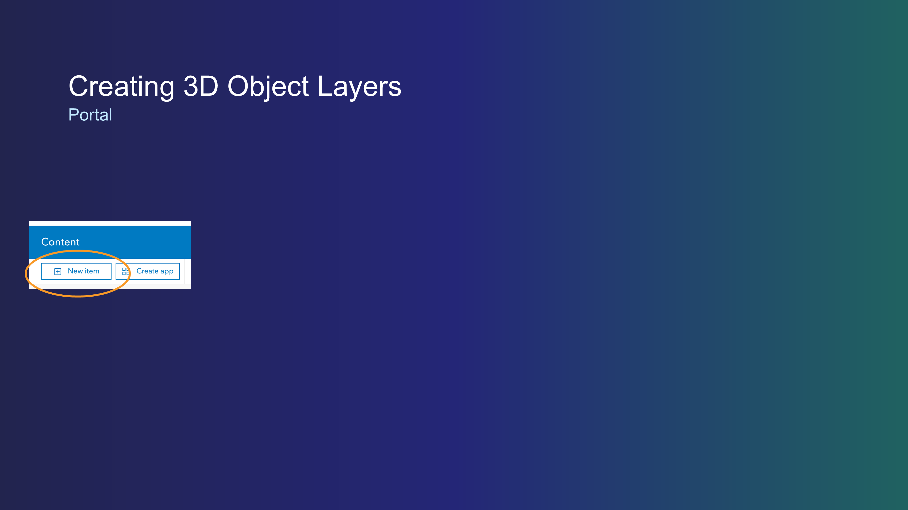
  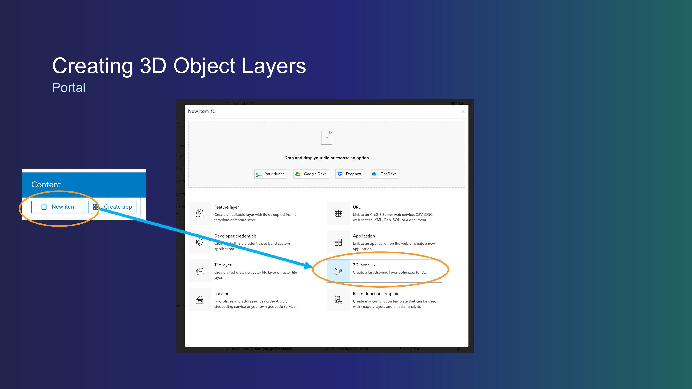
  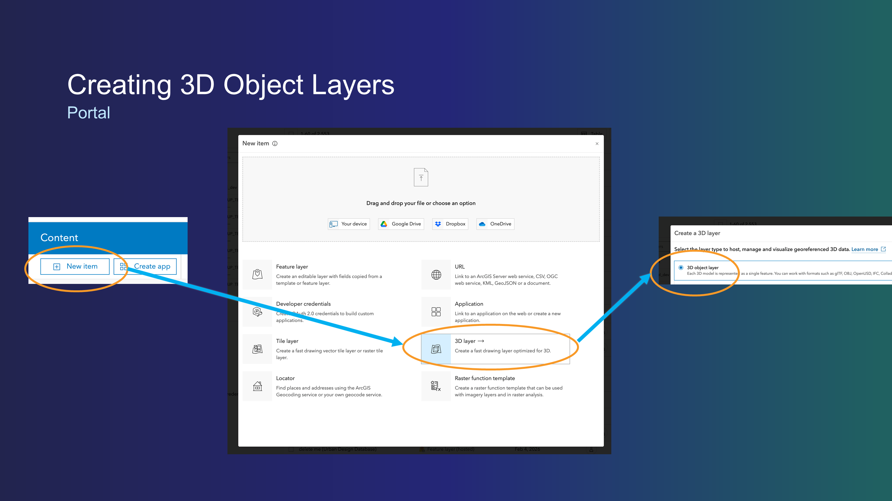
</button>

<!--
- Begin with New item. First click reveals the original first arrow, middle screenshot and its circle; second click reveals the final arrow and 3D object layer dialog. Click the image or use Arrow Right; Arrow Left reverses the builds. The final state is the exact, uncropped PowerPoint 19 export.
- Trace the original portal workflow from left to right. Publishing creates the scene layer and its associated feature layer.
- The UI varies by portal version. Choose the spatial reference before uploading models.
- Source: PowerPoint 19; recording 12:31–13:15.
-->

---

<div class="kicker">CREATE THE LAYER · BEHIND THE SCENES</div>

# Create the service, publish it, initialize the cache

<div class="rest-steps">
  <div><span>1</span><strong>Create the feature service</strong></div>
  <div v-click="1"><span>2</span><strong>Publish the associated scene layer</strong></div>
  <div v-click="2"><span>3</span><strong>Initialize the scene cache</strong></div>
</div>

<!--
- Explain the three creation stages before showing their requests on the following slide.
- Source: PowerPoint 20; recording 13:15–14:22.
-->

---
class: programmatic-layer
---

<div class="kicker">CREATE PROGRAMMATICALLY</div>

# Create the layer programmatically

<div class="programmatic-creation">
  <div class="rest-steps">
    <div><span>1</span><strong>Create the feature service</strong><code>:portalUrl/content/users/:username/createService</code></div>
    <div v-click="1"><span>2</span><strong>Publish the scene layer</strong><code>:portalUrl/content/users/:username/publish</code></div>
    <div v-click="2"><span>3</span><strong>Rebuild the scene cache</strong><code>:sceneServiceAdminUrl/rebuildCache</code></div>
  </div>
  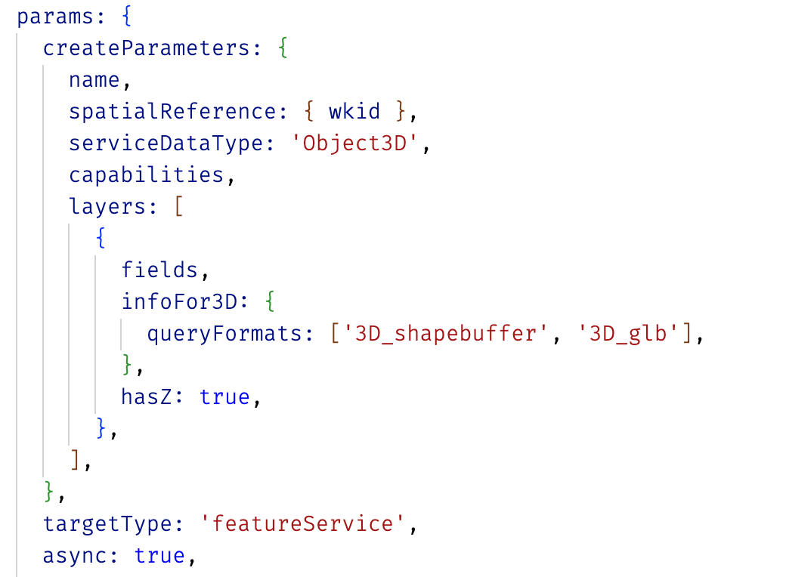
</div>

<!--
- The original request paths use placeholders: portalUrl is the portal REST base, username identifies the account, and sceneServiceAdminUrl is the published scene service administration base.
- Point to the original payload image: serviceDataType Object3D, spatial reference, fields, capabilities, query formats and hasZ.
- These are request excerpts; authentication, complete parameters and asynchronous job handling belong in the application.
- Source: PowerPoint 21; recording 13:15–14:22.
-->

---
layout: intro
class: section-title
---

# Model upload and conversion

<!--
- Section title from original PowerPoint 22; introduce the next part briefly.
-->

---

<div class="kicker">UPLOAD & CONVERSION</div>

# Use the Editor component for standard editing

<div class="image-and-copy editor-example">
  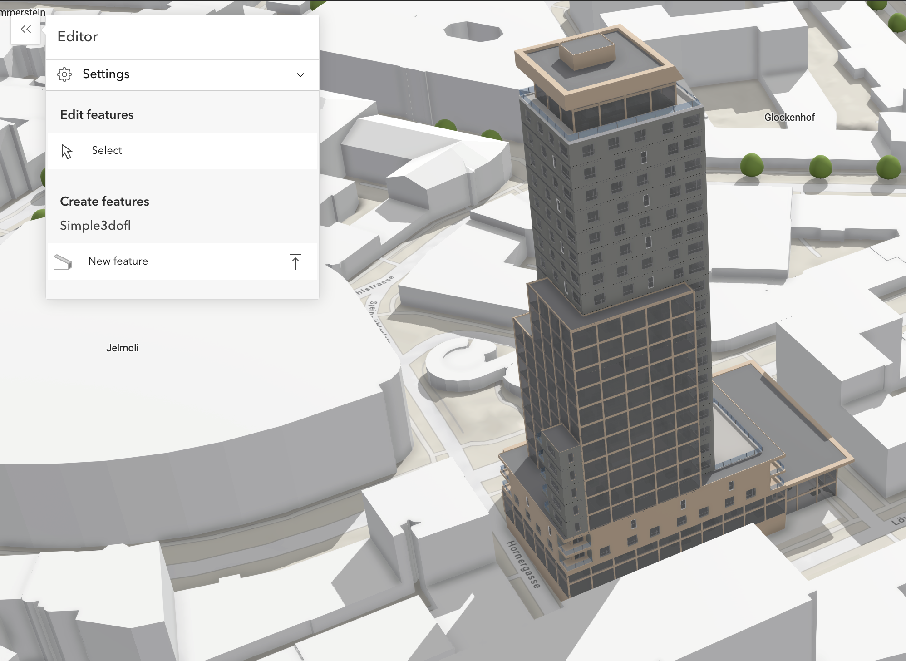
  <div>

```html
<arcgis-scene item-id="…">
  <arcgis-editor slot="top-right">
  </arcgis-editor>
</arcgis-scene>
```

<p>Upload, place and edit models in your application.</p>
  </div>
</div>

<!--
- Scene Viewer provides the ready-made workflow. The Editor component brings the editing experience into a custom web app.
- The web scene must contain a suitable editable 3D object layer. The item ID is a placeholder.
- The source's Editor widget screenshot is retained as an illustration; the typed example uses the component named in the deck.
- Source: PowerPoint 22–24; recording 14:22–16:30.
- Reference: https://developers.arcgis.com/javascript/latest/references/map-components/arcgis-editor/
-->

---

<div class="kicker">CUSTOM WORKFLOWS</div>

# Use Mesh when you need control over the workflow

<div class="image-and-copy">
  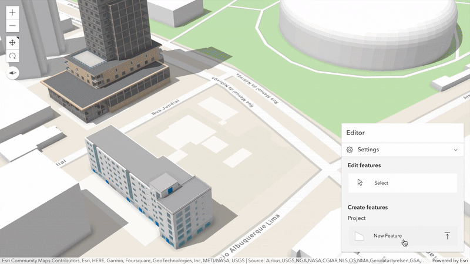
  <div class="numbered-copy"><p><b>1</b> Convert the model.</p><p><b>2</b> Place and manipulate it.</p><p><b>3</b> Save the feature.</p><a href="https://developers.arcgis.com/javascript/latest/sample-code/editing-scenelayer-applyedits/">Open the SDK sample ↗</a></div>
</div>

<!--
- Point to the official upload/applyEdits sample for the complete interaction and persistence workflow.
- A converted model must still be placed and persisted. Mesh is its browser-side geometry representation.
- Source: PowerPoint 25–26; recording 16:30–18:52.
-->

---

<div class="kicker">CONVERSION ≠ PERSISTENCE</div>

# Convert the model, then persist the feature

```ts {1-3|5-7|all}
const { mesh } = await sceneLayer.convertMesh([file], {
  defaultOrigin: view.center.clone(),
});

await sceneLayer.applyEdits({
  addFeatures: [new Graphic({ geometry: mesh })],
});
```

<div class="takeaway">convertMesh → place / adjust → applyEdits</div>

<!--
- The file comes from a file input or drag and drop. The SceneLayer and view already exist.
- convertMesh processes a supported model and returns its mesh; it does not finish persistence.
- Use the returned mesh as the Graphic's geometry. The source screenshot's unbound 'geometry' variable has been corrected.
- Add error handling and inspect edit results in application code; this slide shows the essential sequence.
- Source: PowerPoint 27–28; recording 17:18–20:07.
- API reference: https://developers.arcgis.com/javascript/latest/references/core/layers/SceneLayer/#convertMesh
-->

---

<div class="kicker">GEOREFERENCING</div>

# Give the model an origin in the real world

<div class="origin-flow">
  <div><strong>Embedded placement</strong><p>Use the model's georeferencing information when available.</p></div>
  <div v-click="1"><strong>Fallback placement</strong><p>Use <code>defaultOrigin</code> when the model has no intrinsic origin.</p></div>
  <div v-click="2"><strong>Explicit placement</strong><p>Use <code>origin</code> to override intrinsic placement.</p></div>
</div>

<!--
- IFC4 can include georeferencing information. Many other models have no location, or an unexpected one.
- Distinguish a fallback from an override: they have different effects when the source contains location information.
- Origin placement and the vertex coordinates inside a model are related, but different concepts.
- Source: PowerPoint 29; recording 18:52–20:07.
- API reference: https://developers.arcgis.com/javascript/latest/references/core/layers/SceneLayer/#convertMesh
-->

---

<div class="kicker">PRECISE PLACEMENT</div>

# Let the user enter exact coordinates

<div class="image-and-copy">
  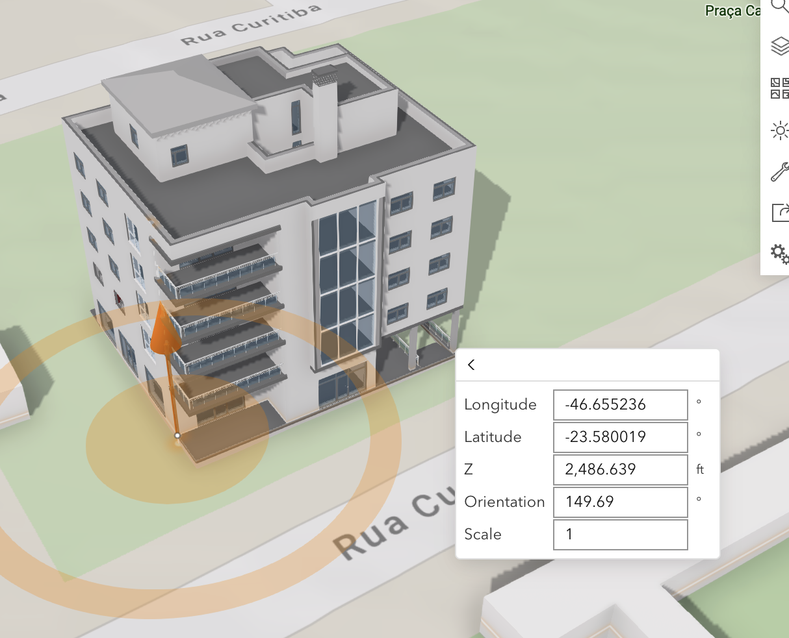
  <div>

```ts
sketchViewModel.tooltipOptions.enabled = true;

sketchViewModel.place(mesh);
```

<p>Use the placement tools for position, rotation and scale.</p>
  </div>
</div>

<!--
- Tooltips support precise input during placement; Tab opens coordinate input in the demonstrated workflow.
- Scene Viewer and the Editor provide these interactions; SketchViewModel provides lower-level control.
- Source: PowerPoint 29; recording 20:07–21:03.
-->

---

<div class="kicker">RESPOND TO MODEL METADATA</div>

# Check placement information before saving

```ts {1|3-7|8-10|all}
const { mesh, georeferenceInfo } = await sceneLayer.convertMesh([file]);

if (georeferenceInfo) {
  const graphic = new Graphic({ geometry: mesh, symbol: meshSymbol });
  graphicsLayer.add(graphic);
  sketchViewModel.update(graphic);
  view.goTo(graphic);
} else {
  sketchViewModel.place(mesh);
}
```

<div class="takeaway">If the origin was reprojected, check the placement accuracy.</div>

<!--
- This example assumes graphicsLayer, meshSymbol and sketchViewModel have been configured.
- convertMesh projects the origin into the layer’s spatial reference; full per-vertex reprojection is not supported, which can affect accuracy. Compare georeferenceInfo.origin.spatialReference with mesh.spatialReference.
- This is the placement branch; persist after placement completes, using applyEdits as on the previous slide.
- Source: PowerPoint 30; recording 21:03–23:41.
- API reference: https://developers.arcgis.com/javascript/latest/references/core/layers/SceneLayer/#convertMesh
-->

---
clicks: 3
---

<div class="kicker">VERTEX SPACES</div>

# Local vertices need a geographic origin

<div class="vertex-comparison">
  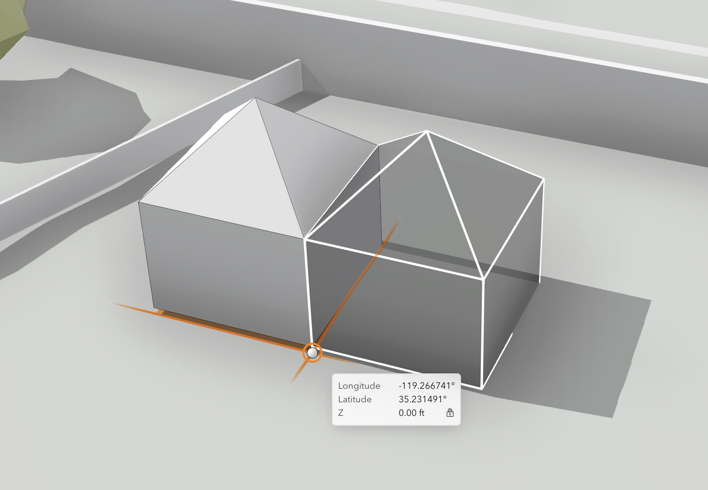
  <div>
    <div v-click="1"><strong>Georeferenced vertices</strong><p>Each vertex has coordinates in the spatial reference.</p></div>
    <div v-click="2"><strong>Local vertices</strong><p>An origin locates the model.<br>Its vertices are offsets from that origin.</p></div>
  </div>
</div>

<DemoActions live-url="demos/vertex-spaces/index.html" :video-click="3" />

<script setup>
import demoPoster from '/media/vertex-spaces-poster.png';
</script>

<div v-click="3" class="demo-overlay">
  <SlidevVideo v-if="$clicks >= 3" autoplay="once" autoreset="slide" controls muted playsinline preload="metadata" :poster="demoPoster" aria-label="Compare vertex coordinates, the local origin and triangle indices using highlighted scene points">
    <source src="/media/vertex-spaces.mp4" type="video/mp4" />
  </SlidevVideo>
</div>

<!--
- Explain both representations, then use the final click to show the standalone demo recording.
- For a live demonstration, choose Open live demo. Return here and choose Next slide to continue without the video; Play video is the fallback.
- Follow world-coordinate vertices, then local offsets and origin, then the triangle indices. The yellow marker connects each number to its point in the scene.
- Open the standalone demo to switch between the actual vertex buffers beside the scene. Both meshes stay visible; this compares representations, not an animated conversion.
- Source: PowerPoint 31 and hidden 33–37; Esri explanation 24:17–26:11.
- Video: standalone demo recorded locally on 19 October 2026, SDK 5.1.27; 1:19.
-->

---

<div class="kicker">CONVERT BETWEEN REPRESENTATIONS</div>

# Convert vertex space for the operation you need

```ts
const origin = [center.x, center.y, center.z];

const localMesh = await convertVertexSpace(
  mesh,
  new MeshLocalVertexSpace({ origin }),
);
```

<div class="takeaway">A vertex offset becomes a map location through its origin and vertex space.</div>

<!--
- convertVertexSpace and MeshLocalVertexSpace are imported from the SDK; center is a point in the appropriate spatial reference.
- Useful when generating geometry, exporting models, or locating a model vertex on the map.
- Use SDK transformations, not hand-written longitude/latitude arithmetic.
- Source: PowerPoint 31; recording 26:11–26:47 and 31:35–32:08.
-->

---
layout: intro
class: section-title
---

# Spatial references

<!--
- Section title from original PowerPoint 32; introduce the next part briefly.
-->

---
clicks: 2
---

<div class="kicker">SPATIAL REFERENCES</div>

# Match the coordinate system to the scene

<div class="original-diagram original-diagram-tall">
  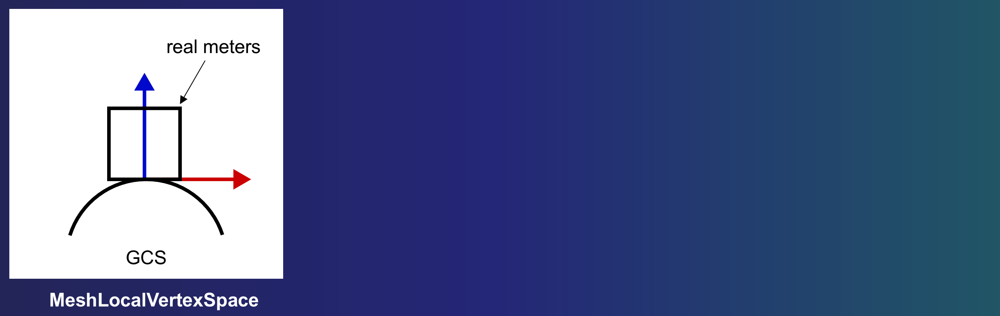
  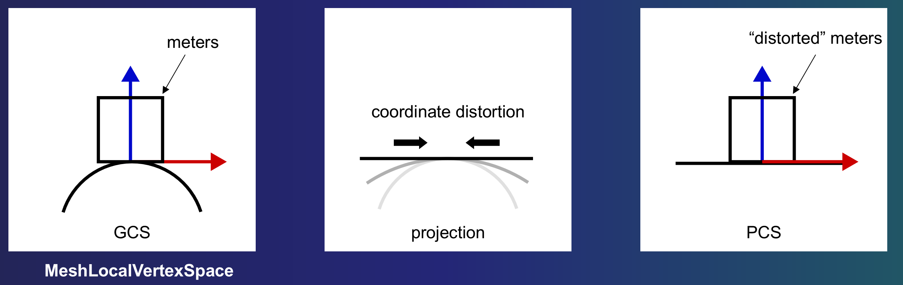
  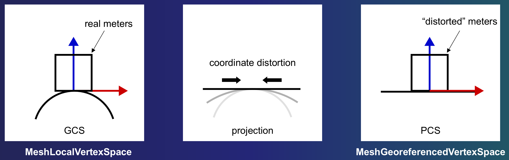
</div>

<!--
- Separate the layer's spatial reference, the scene's viewing mode and the model's vertex space.
- Local scene and local vertex space are not synonymous. Choose a supported combination.
- Restore the original hidden-slide illustrations: local coordinates (34), projection (36), then georeferenced vertex space (37). Explain GCS as geographic and PCS as projected coordinates; local vertex space does not mean local scene.
- Source: PowerPoint 32–37; recording 26:47–29:16.
-->

---
clicks: 3
---

<div class="kicker">WEB MERCATOR</div>

# Map distortion also affects 3D model placement

<div class="mercator-comparison">
  <div class="original-diagram original-diagram-tall">
    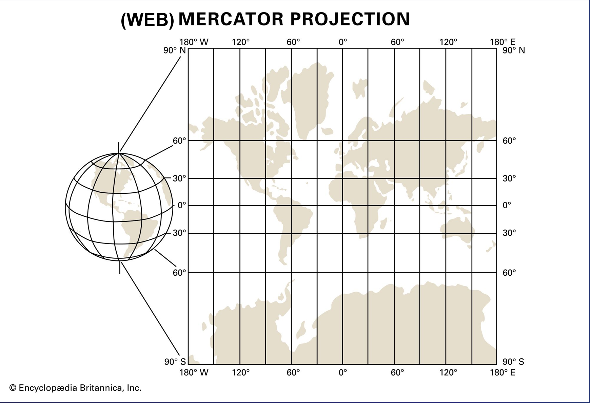
    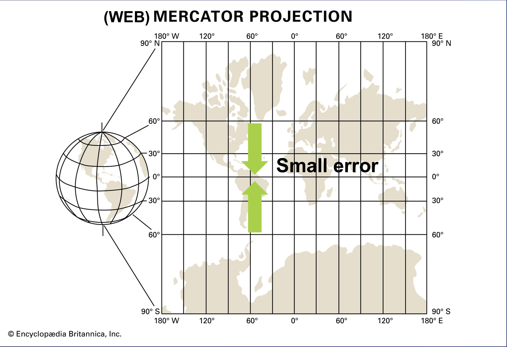
    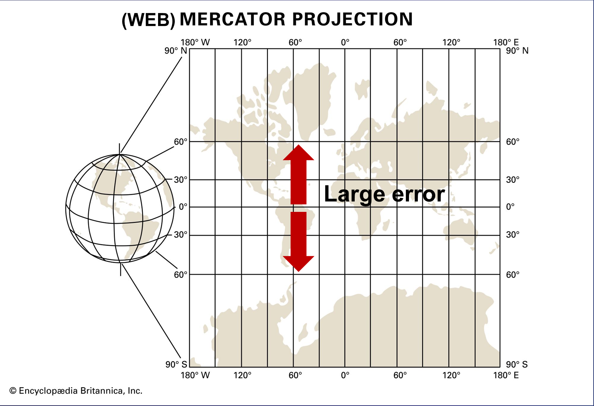
  </div>
  <div class="mercator-explanation">
    <p>Scale distortion increases away from the equator.</p>
    <div v-click="3" class="takeaway">For a global or Web Mercator scene, use WGS84 for the 3D object layer.</div>
  </div>
</div>

<!--
- Use the original Mercator graphic and its green/red annotation states from PowerPoint 38–40, retaining the Encyclopaedia Britannica attribution. Click through the map, small error near the equator, large error farther away, then the layer recommendation. This is qualitative, not a numerical distortion analysis.
- The recommendation applies to the 3D object layer, not a blanket ban on Web Mercator scenes.
- Do not repeat the recording's tentative claim that every creation interface disables Web Mercator.
- Source: PowerPoint 38–40; recording 27:17–29:48.
-->

---

<div class="kicker">CHOOSE BEFORE YOU PUBLISH</div>

# Which spatial reference should the layer use?

<div class="original-diagram original-diagram-tall">
  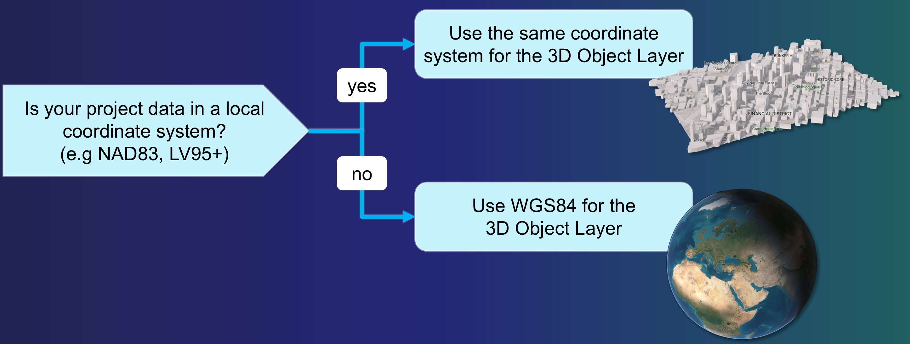
</div>

<!--
- Use the original city/globe decision tree from PowerPoint 41. Trace both branches; the original local-system examples are illustrative. Reuse this rule when explaining a real project; distinguish layer coordinates from the displayed basemap.
- Confirm the viewing mode and service capabilities, not just the WKID of the basemap.
- Source: PowerPoint 41, 48; recording 28:30–29:48 and 42:52–43:05.
-->

---
layout: intro
class: section-title
---

# Query and manipulation

<!--
- Section title from original PowerPoint 42; introduce the next part briefly.
-->

---

<div class="kicker">QUERY & MANIPULATION</div>

# Query a mesh—or just its footprint

```ts {1-3|5-8|all}
const query = sceneLayer.createQuery();
query.objectIds = [objectId];
query.returnGeometry = true;

const { features } = await sceneLayer.queryFeatures(query);
const mesh = features[0].geometry;

await mesh.load();
```

<div v-click="3" class="takeaway"><code>query.multipatchOption = 'xyFootprint'</code> requests the 2D footprint instead.</div>

<!--
- The shown query assumes a valid objectId and a layer capable of returning mesh geometry.
- Load the mesh before reading its vertices or components. In application code, handle empty results and check geometry type.
- Use a separate footprint query when the task needs a polygon rather than all model vertices.
- Source: PowerPoint 42–43; recording 29:48–30:36 and 32:08–32:40.
- Reference: https://developers.arcgis.com/javascript/latest/references/core/geometry/Mesh/
-->

---
clicks: 2
---

<div class="kicker">EXAMPLE · PRAGUE</div>

# Compare a proposal with its surroundings

<div class="demo-still">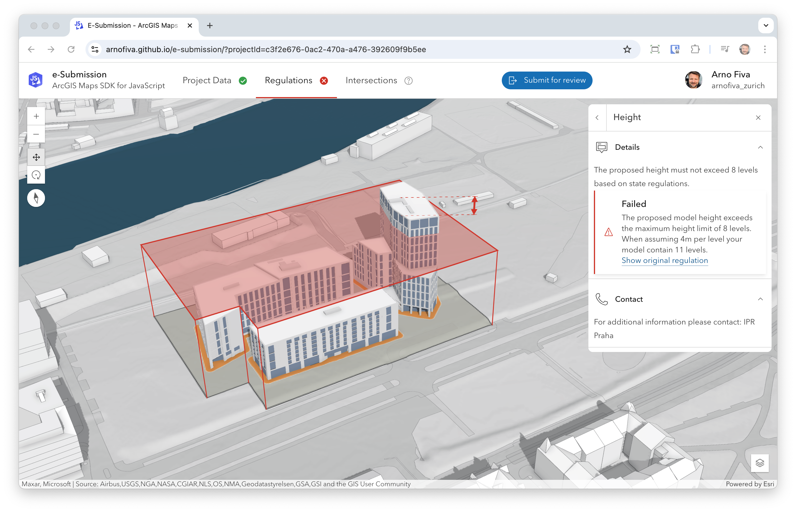</div>
<div v-click="1" class="demo-points"><span>Model vertices → height checks</span><span>Footprint → GIS intersections</span></div>

<DemoActions live-url="https://arnofiva.github.io/e-submission/" :video-click="2" />

<script setup>
import demoPoster from '/media/prague-building-checks-poster.png';
</script>

<div v-click="2" class="demo-overlay">
  <SlidevVideo v-if="$clicks >= 2" autoplay="once" autoreset="slide" controls muted playsinline preload="metadata" :poster="demoPoster" aria-label="Prague e-submission demo showing building height checks and infrastructure intersections">
    <source src="/media/prague-building-checks.mp4" type="video/mp4" />
  </SlidevVideo>
</div>

<!--
- Final click plays the recorded demonstration; narrate the geometry-to-analysis connection.
- Open live demo is optional and currently requires access to its ArcGIS content. Return and choose Next slide to skip the recording, or Play video as the fallback. Rehearsal: LIVE_DEMOS.md.
- Check model height against an illustrative regulation layer and locate the high point using vertex-space conversion.
- Height above ground is not the same as absolute vertex elevation. A real check needs consistent units, ground reference and the applicable height definition.
- The footprint supports spatial intersections, such as the gas-pipeline example. These are custom app checks.
- Source: PowerPoint 43; Esri recording 30:49–33:10.
- Video source: https://mediaspace.esri.com/media/t/1_cwrea8bp
-->

---

<div class="kicker">EXPORT</div>

# Export mesh geometry as a GLB model

```ts
await mesh.load();
const buffer = await mesh.toBinaryGLTF();

const blob = new Blob([buffer], {
  type: 'model/gltf-binary',
});
```

<div class="export-flow"><span>Building meshes</span><b>+</b><span>Terrain mesh</span><b>→</b><span>GLB</span><b>→</b><span>Modeling tools</span></div>

<!--
- toBinaryGLTF produces an ArrayBuffer; the browser can offer the Blob as a file download.
- The portal example first queries buildings, generates terrain and brings their meshes into a compatible vertex space.
- A GLB can contain individual objects; exporting as one file does not have to flatten everything into one undifferentiated object.
- Source: PowerPoint 44; recording 33:25–35:41.
- Reference: https://developers.arcgis.com/javascript/latest/references/core/geometry/Mesh/#toBinaryGLTF
-->

---
clicks: 2
---

<div class="kicker">EXAMPLE · CITY DOWNLOAD PORTAL</div>

# Take buildings and terrain into Blender

<div class="demo-still"></div>
<div v-click="1" class="demo-points"><span>Select → export GLB → model</span><span>Keep a shared origin</span></div>

<DemoActions live-url="https://esri.github.io/city-download-portal/" :video-click="2" />

<script setup>
import demoPoster from '/media/city-download-blender-poster.png';
</script>

<div v-click="2" class="demo-overlay">
  <SlidevVideo v-if="$clicks >= 2" autoplay="once" autoreset="slide" controls muted playsinline preload="metadata" :poster="demoPoster" aria-label="Export a St. Gallen city area and inspect a prepared city model in Blender">
    <source src="/media/city-download-blender.mp4" type="video/mp4" />
  </SlidevVideo>
</div>

<!--
- Final click plays the recorded portal and Blender workflow.
- Open live demo starts at the city chooser. Select St. Gallen and use the prepared Blender model from the same area. Return and choose Next slide to skip the recording, or Play video as the fallback. Rehearsal: LIVE_DEMOS.md.
- Buildings and terrain become editable objects in a modeling tool. A shared origin supports bringing designs back into GIS.
- The original presenter opens a preloaded Blender model of a different area; do not describe it as the just-completed export.
- A further use case is preparing geometry for 3D printing.
- Source: PowerPoint 44; Esri recording 34:40–36:36 (cut before presenter layout).
- App and source: https://github.com/Esri/city-download-portal
- Video source: https://mediaspace.esri.com/media/t/1_cwrea8bp
-->

---

<div class="kicker">MODEL METADATA · SDK 5.1</div>

# Inspect source and derived models

```ts {1-3|5-8|all}
const modelsByObjectId = await sceneLayer.queryModels({
  objectIds: [objectId],
});

const models = modelsByObjectId.get(objectId) ?? [];
for (const model of models) {
  console.log(model.format, model.isSource, model.size);
}
```

<div class="takeaway">One feature can have a source model and derived formats.<br>Inspect metadata before downloading files.</div>

<!--
- New SDK 5.1 material, replacing the original deck's raw associated-layer query3d request. Requires an associated feature layer with 3D object support.
- queryModels returns Map<ObjectId, ModelInfo[]>: each feature can have several model representations. ModelInfo exposes format, isSource, files and size.
- Metadata is separate from file bytes and displayable Mesh geometry. For Mesh, use queryFeatures({ returnGeometry: true }) on a capable layer.
- objectId is an existing feature ID. Handle missing results and errors in application code.
- Original context: PowerPoint 45; recording 37:35–39:23. API update checked 19 October 2026.
- References: https://developers.arcgis.com/javascript/latest/sample-code/query-models/ and https://developers.arcgis.com/javascript/latest/references/core/layers/SceneLayer/#queryModels
-->

---

<div class="kicker">DOWNLOAD ON DEMAND · SDK 5.1</div>

# Download the model the workflow needs

```ts {1|3|5-9|all}
const source = await sceneLayer.queryModel(objectId);

const glb = await sceneLayer.queryModel(objectId, { format: 'glb' });

if (glb) {
  for (const file of glb.files) {
    const bytes = await file.arrayBuffer();
    // Offer these bytes as a file download.
  }
}
```

<!--
- queryModel without a format requests the source. A format requests a matching source or derived model when available; do not assume a requested format is necessarily derived.
- Both calls return ModelInfo metadata or undefined. Each ModelFileInfo.arrayBuffer() retrieves that file's content. Handle every file of a multi-file model, errors and the browser download action.
- Check sceneLayer.capabilities.data.queryFormats for service-supported formats. Read actual results; the sample does not promise an IFC source.
- Continue to the following screenshot slide for the live sample. Explain IDs → metadata → bytes before demonstrating.
- This sample runs in the official page's playground; there is no /live/ endpoint. No embedded recording exists for this new demo. If unavailable, use the code and sample screenshot; the IFC video is a separate example.
- Original context: PowerPoint 45. New sample: https://developers.arcgis.com/javascript/latest/sample-code/query-models/
- API references: https://developers.arcgis.com/javascript/latest/references/core/layers/SceneLayer/#queryModel and https://developers.arcgis.com/javascript/latest/references/core/layers/scene/ModelFileInfo/#arrayBuffer
-->

---

<div class="kicker">EXAMPLE · QUERY 3D MODELS</div>

# Select a building and download its models

<div class="sample-preview">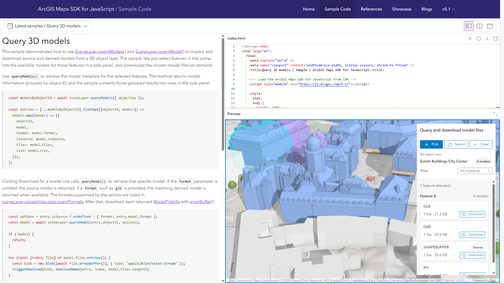</div>

<div class="model-query-demo">
  <span>Pick → inspect formats → download</span>
  <a href="https://developers.arcgis.com/javascript/latest/sample-code/query-models/?view=full" target="_blank" rel="noopener">Open sample and code ↗</a>
</div>

<!--
- A real screenshot of the official SDK 5.1 sample page, captured in Windows Chrome on 19 October 2026. Description view shows the explanation, code editor and scene preview together.
- Explain the APIs on slides 36–37, then demonstrate here. Pick a building, inspect Source models, switch Show to All models, download an available GLB, then Clear. Selecting a small polygon is optional.
- The slide link and tab launcher request ?view=full to show Description view, with the explanation and code beside the scene preview. Keep that view for the API walkthrough.
- If the live sample is unavailable, use this screenshot and the preceding code. There is no recording for this new demo. Read the source badge rather than assuming IFC is the original format.
- Source: https://developers.arcgis.com/javascript/latest/sample-code/query-models/
-->

---
clicks: 2
---

<div class="kicker">EXAMPLE · CUSTOM IFC VIEWER</div>

# Read floors and spaces from the original IFC

<div class="demo-still">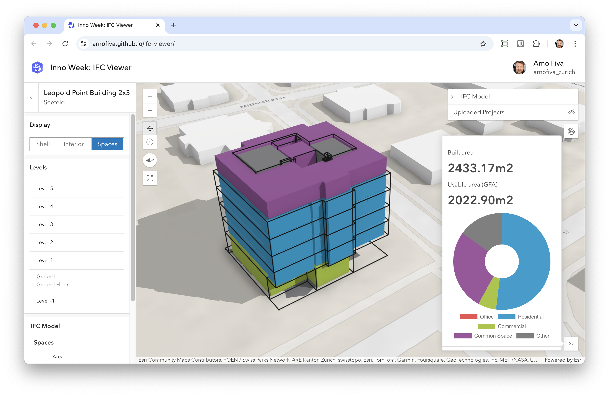</div>
<div v-click="1" class="demo-points"><span>Download IFC → parse in the browser</span><span>Custom client-side workflow</span></div>

<DemoActions live-url="https://arnofiva.github.io/ifc-viewer/" :video-click="2" />

<script setup>
import demoPoster from '/media/ifc-viewer-poster.png';
</script>

<div v-click="2" class="demo-overlay">
  <SlidevVideo v-if="$clicks >= 2" autoplay="once" autoreset="slide" controls muted playsinline preload="metadata" :poster="demoPoster" aria-label="Custom IFC application showing building parts, floor filtering and usage statistics">
    <source src="/media/ifc-viewer.mp4" type="video/mp4" />
  </SlidevVideo>
</div>

<!--
- Final click plays the recorded IFC viewer workflow.
- Open live demo is optional and currently requires access to its ArcGIS content. Return and choose Next slide to skip the recording, or Play video as the fallback. Rehearsal: LIVE_DEMOS.md.
- A building is one feature in the source layer. The app downloads the IFC and uses web-ifc to create client-side geometries for individual parts and spaces.
- Explain floor filtering and usage statistics as custom application logic, not built-in 3D Object Layer capabilities.
- This is not a Building Scene Layer demonstration.
- Source: PowerPoint 45; Esri recording 38:32–41:33.
- App source: https://github.com/arnofiva/ifc-viewer
- Video source: https://mediaspace.esri.com/media/t/1_cwrea8bp
-->

---
layout: intro
class: section-title
---

# Takeaways

<!--
- Section title from original PowerPoint 46; introduce the next part briefly.
-->

---

<div class="kicker">API RECAP</div>

# Three APIs carry the core workflow

<div class="api-trio recap">
  <div><strong>SceneLayer</strong><code>convertMesh() · applyEdits()</code><code>queryFeatures()</code><code>queryModels() · queryModel()</code></div>
  <div v-click="1"><strong>Mesh</strong><code>vertexSpace</code><code>transform</code><code>toBinaryGLTF()</code></div>
  <div v-click="2"><strong>meshUtils</strong><code>convertVertexSpace()</code><p>Convert coordinates for the next operation.</p></div>
</div>

<!--
- The scene layer API handles standard model editing and queries through the associated feature layer.
- Mesh exposes the geometry representation; meshUtils provides coordinate conversion utilities.
- For loading a GLB directly, the source deck also points to Mesh.createFromGLTF. Check the target SDK version when implementing, since 5.1 introduces module-level helpers.
- Source: PowerPoint 46–47; recording 41:45–42:52.
-->

---

<div class="kicker">TAKEAWAYS</div>

# Store the model. Locate it correctly. Build on it.

<div class="three-steps takeaways">
  <div><span>1</span><strong>Use the layer as the record</strong><p>Keep original assets and manage features through the SDK.</p></div>
  <div v-click="1"><span>2</span><strong>Choose coordinates deliberately</strong><p>Align spatial references, origins and vertex spaces.</p></div>
  <div v-click="2"><span>3</span><strong>Extend the workflow</strong><p>Analyze geometry, export models or interpret source data.</p></div>
</div>

<!--
- Return to the opening story: the same stored model can support Scene Viewer, XR and specialized applications.
- Repeat the decision rule: matching local system for a local project; WGS84 layer for a global/Web Mercator scene.
- Source: PowerPoint 47–48; recording 41:45–43:05.
-->

---

<div class="kicker">RESOURCES</div>

# Continue with the guides and working examples

<div class="resource-columns">
  <div><strong>Learn the workflow</strong><ul>
    <li><a href="https://developers.arcgis.com/javascript/latest/3d-object-workflows/">3D object workflows in the SDK</a></li>
    <li><a href="https://developers.arcgis.com/javascript/latest/sample-code/editing-scenelayer-applyedits/">Upload models and applyEdits sample</a></li>
    <li><a href="https://www.esri.com/arcgis-blog/products/arcgis-online/3d-gis/3d-object-layer-a-comprehensive-overview/">3D Object Layer overview</a></li>
    <li><a href="https://developers.arcgis.com/javascript/latest/references/core/layers/SceneLayer/">SceneLayer reference</a></li>
  </ul></div>
  <div><strong>Explore the examples</strong><ul>
    <li><a href="https://github.com/Esri/city-download-portal">City Download Portal — source</a></li>
    <li><a href="https://github.com/arnofiva/ifc-viewer">Custom IFC viewer — source</a></li>
    <li><a href="https://developers.arcgis.com/javascript/latest/sample-code/query-models/">Query source and derived models — sample</a></li>
    <li><a href="https://mediaspace.esri.com/media/t/1_cwrea8bp">Original Esri session recording</a></li>
    <li><a href="./demos/vertex-spaces/index.html" target="_blank" rel="noopener">Vertex spaces — live code comparison</a></li>
  </ul></div>
</div>

<!--
- Credit the original Esri deck and recording for the examples and demonstration footage.
- For geometry details, follow the Mesh and meshUtils references from the workflow guide.
- Source: PowerPoint 49, 52; recording 43:05–43:25.
-->

---
layout: intro
---

# Questions

Which 3D workflow are you building?

<!--
- Useful Q&A topics from the recording: multipatch versus 3D object workflows, underground data, model complexity, and choosing another scene-layer type.
- Do not give a universal model-count limit. Model detail, caching and the workflow matter.
- Source: PowerPoint 50; recording 43:25–55:09.
-->

---
is: feedback
---

<!--
- Invite feedback through the session survey.
- Source: PowerPoint 51; repeat the opening survey reminder at the end.
-->

---
layout: none
class: original-slide
is: social
title: Connect with us on social
---

# Connect with us on social


<a class="original-social-link" style="top: 32%" href="https://x.com/EsriDevs" target="_blank" rel="noopener" aria-label="Esri developers on X"></a>
<a class="original-social-link" style="top: 40.5%" href="https://x.com/EsriDevEvents" target="_blank" rel="noopener" aria-label="Esri developer events on X"></a>
<a class="original-social-link" style="top: 49%" href="https://www.youtube.com/@EsriDevs" target="_blank" rel="noopener" aria-label="Esri developers on YouTube"></a>
<a class="original-social-link" style="top: 57.5%" href="https://links.esri.com/DevVideos" target="_blank" rel="noopener" aria-label="Esri developer videos"></a>
<a class="original-social-link" style="top: 66%" href="https://github.com/Esri" target="_blank" rel="noopener" aria-label="Esri on GitHub"></a>
<a class="original-social-link" style="top: 74.5%" href="https://github.com/EsriDevEvents" target="_blank" rel="noopener" aria-label="Esri developer events on GitHub"></a>
<a class="original-social-link" style="top: 83%" href="https://links.esri.com/EsriDevCommunity" target="_blank" rel="noopener" aria-label="Esri developer community"></a>

<!--
- Invite attendees to follow Esri's developer channels and use #EUDevTech2026.
- Source: PowerPoint 52. Exact native slide export; transparent links preserve the original channels.
-->

---
is: esri
---

<!--
- Source: PowerPoint 53. Preserve Esri's source attribution.
-->
